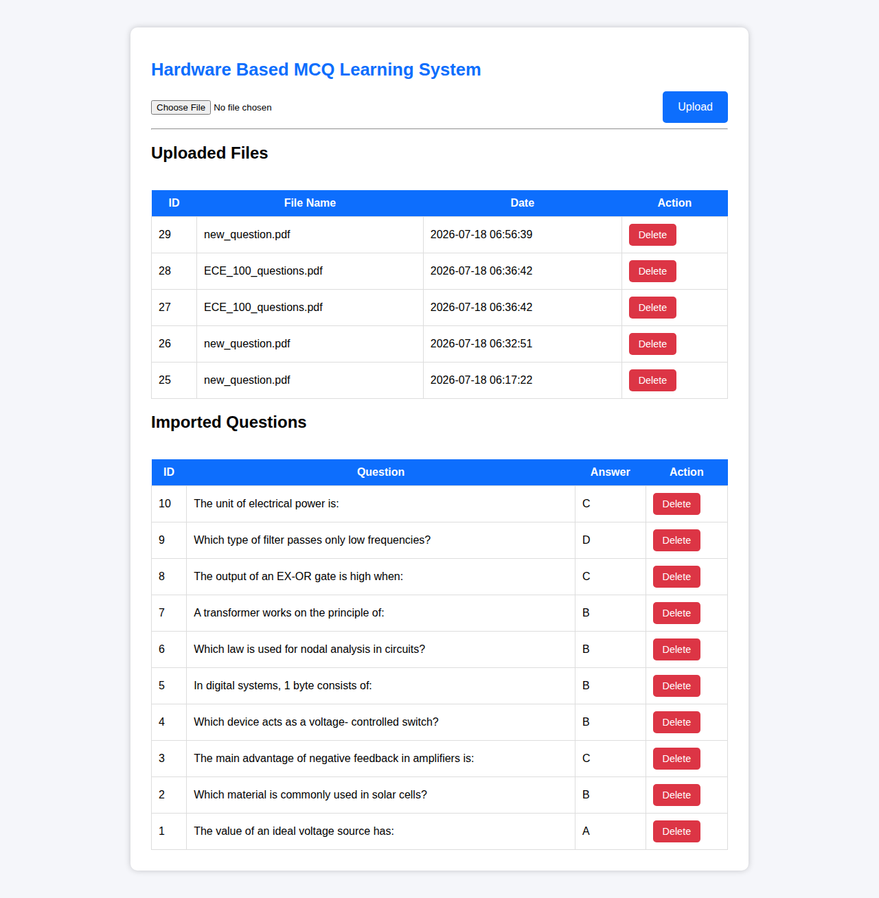
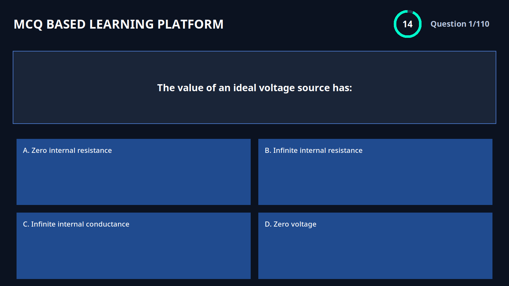
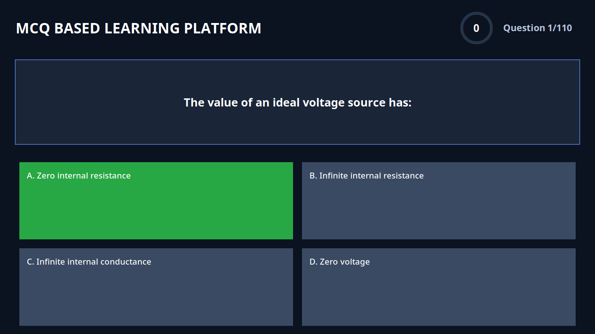
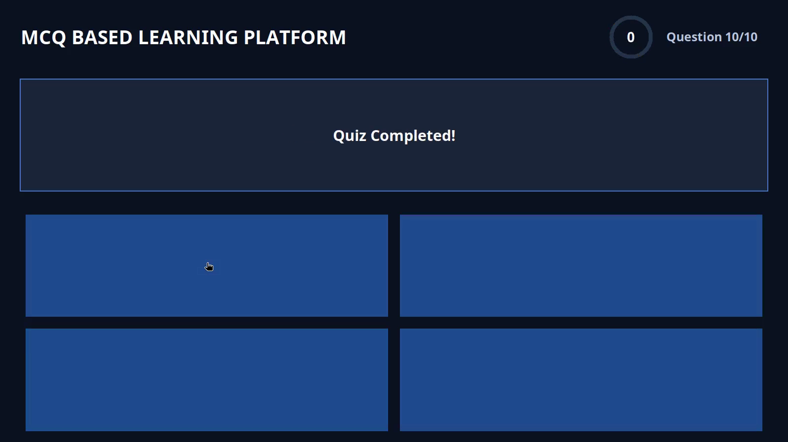

# Hardware Based MCQ Learning System using Raspberry Pi

A touch-based MCQ learning system for students: teachers upload a PDF of questions, the server stores them in a database, and the quiz runs on a touch display with a 15-second countdown per question. Built as a **Design Engineering 2B (3160001)** project, B.E. Semester 6, Electronics & Communication, Government Engineering College, Bhavnagar (GTU).

**Team:** Nitesh Kumar (240213111018) · Sandhya Kumari (240213111013) · **Rajan Yadav (240213111019)**
**Guide:** Associate Prof. Dhara Dave · **HoD:** Dr. Hasmukh Koringa

**Live demo (admin panel):** _coming soon — deploying on Render_
**Full project report:** [`docs/DE_2B__Report.pdf`](docs/DE_2B__Report.pdf)

## How it works

1. **Server first** — the Flask admin panel (`server/`) runs on the Raspberry Pi. Upload a question PDF/DOCX and it is parsed into the SQLite database.
2. **Quiz second** — the Tkinter quiz UI (`quiz/`) runs on the Pi's touch display. It reads the same questions from the database, shows one question at a time with a 15-second circular countdown, and auto-advances.
3. A student taps an option on the touch screen. Correct = green, wrong = red, and the correct answer is revealed when time runs out.

## Categories — everything, divided by category

| Category | Folder | What is inside |
|---|---|---|
| **Server (admin panel)** | [`server/`](server/) | Flask app: upload PDF/DOCX, parse questions into SQLite, list/delete files & questions. `app.py`, `parser.py`, `database.py`, `config.py`, `templates/`, `static/`, `uploads/`, `mcq.db` (10 questions), `requirements.txt`. Run: `python app.py` → http://localhost:5000 |
| **Quiz UI (touch display)** | [`quiz/`](quiz/) | Tkinter quiz: typewriter question, 15-sec countdown ring, 4 tap options in a 2×2 grid, auto-advance. `timer.py`, `database_manager.py`, `mcq.db` (10 questions). Run: `python timer.py` |
| **Project report** | [`docs/`](docs/) | The full Design Engineering 2B report — goal, canvases, code, errors, prototype, testing, conclusion (65+ pages, PDF). |
| **Question banks** | [`question-banks/`](question-banks/) | Source question PDFs: `ECE_100_questions.pdf` (100 ECE questions), `ece_questions.pdf`, `new_question.pdf`. Upload any of these in the admin panel to add them to the database. |
| **Designs** | [`designs/`](designs/) | Early design references: `quiz-ui-mockup.png` (professional quiz UI concept) and `timer-code-reference.png` (an earlier timer.py version). Reference only — the running UI is in `quiz/`. |
| **Screenshots** | [`screenshots/`](screenshots/) | Real screenshots of the working system: the admin panel, the quiz UI, the answer-reveal state, and the Quiz Completed screen. |
| **Videos** | [`videos/`](videos/) | Real recordings: the full 10-question quiz run (tap answer, countdown, reveal, Quiz Completed) and the PDF upload in the admin panel (10 → 110 questions). |

## Screenshots

### Admin panel (Flask server)



### Quiz UI (touch display)



### Answer reveal — correct answer turns green when time runs out



### Quiz Completed — after the last question



## Videos

### Quiz running — full 10-question run (tap answer, countdown, reveal, Quiz Completed)

<video src="videos/quiz-demo.mp4" controls width="100%"></video>

[Watch the quiz video](videos/quiz-demo.mp4)

### Uploading a question PDF — 10 questions become 110

<video src="videos/upload-demo.mp4" controls width="100%"></video>

[Watch the upload video](videos/upload-demo.mp4)

## Hardware

- Raspberry Pi 3 Model B (BCM2711, quad-core, 1 GB RAM)
- HDMI LCD touch display (7–15.6")
- MicroSD card 16–64 GB, Raspberry Pi OS 64-bit
- Power supply, HDMI cable

## Software & skills

Python · Flask · Tkinter · SQLite · pdfplumber · python-docx · PyMuPDF · Pillow · Raspberry Pi · IoT · Embedded Systems

## Run it on the Raspberry Pi

```bash
# 1. Server first (admin panel)
cd server
pip install -r requirements.txt
python app.py        # http://<pi-ip>:5000 — upload question PDFs here

# 2. Quiz second (touch display)
cd ../quiz
python timer.py      # opens full-screen on the display, tap options directly
```

On power-on the quiz UI opens directly and the database keeps running in the background. No keyboard or mouse needed — touch only.

## Verified working

- Admin panel runs and lists 5 uploaded files + 10 imported questions (screenshot above).
- Uploading `ECE_100_questions.pdf` imports 100 questions — the database grows from 10 to 110 questions.
- Quiz UI runs: question types out, countdown runs 15 → 0 (green → yellow → red), correct answer turns green on reveal, then auto-advances to the next question.

## Notes

- The web demo is the **admin panel only**. The Tkinter quiz needs a display, so it runs on the Pi's touch screen — its screenshots above show it working.
- After the last question the quiz shows "Quiz Completed!" and stops.
- `gunicorn` in `server/requirements.txt` is only for the web demo deploy (Render). The Pi does not need it.
- The report lists some template leftovers (e.g. "Role of ESP32-CAM Module", "Role of Flame Sensor") — they are part of the original report and are kept as-is.
